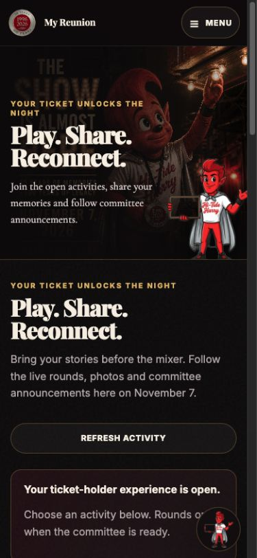
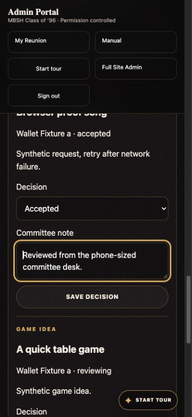

# Play. Share. Reconnect. — morning walkthrough

Release `reunion-experience-20261023`. The exact deployed source revision and hosted checks are in `receipt.json`. Owner acceptance is **pending Fritz’s uncoached morning review**. The two screenshots below show synthetic local test accounts; they do not show customer participation.

Open the [homepage invitation](https://mbsh96reunion.com/#reunion-experience), [sign in](https://mbsh96reunion.com/portal/login), or use the [phone field guide](https://mbsh96reunion.com/manual/#ticket-holder-games). The existing manual retains the complete navigation map. New attendee controls are under Menu → Reunion Experience; staff controls are under Reunion activities and 1996 Trivia.

For a first visit, use the email attached to a valid paid mixer admission and complete email verification. Registration alone does not unlock play. A refunded/revoked or unmatched admission does not remove access to sign-in, account help, or the ticket wallet. Committee permissions remain separately assigned; no new roles were granted by this release.

## Start here on your phone

1. Open [My Reunion Experience](https://mbsh96reunion.com/portal/#experience). Check the five activity links and the current-round message. A draft bank does not mean a round is open.
2. Open [committee activities](https://mbsh96reunion.com/portal/admin/#activities). Expand the queues. A committee member sees only their permitted queues; leads and the site owner also manage games.
3. Open [1996 Trivia](https://mbsh96reunion.com/portal/admin/#trivia), expand the starter draft and review its questions, choices, explanations and source links. Leave it draft until the committee is ready to run it.
4. For the first real submission, make a decision, save it, then refresh and check the saved status. Tell Fritz if the expected tool is absent or the result does not persist.

## Real tasks and reversals

| Capability / task | Role, route and steps | Saved result and visibility | Correction or reversal | Owner result |
| --- | --- | --- | --- | --- |
| `experience-access` / T01 | Verified paid holder: sign in → [experience](https://mbsh96reunion.com/portal/#experience) | Current Woo admission is checked; the five participation controls become available | Verify the same ticket email; use wallet/help if unmatched. Staff never create a duplicate ticket to bypass access | Pending |
| `trivia-1996` / T02 | Lead/owner: [Trivia](https://mbsh96reunion.com/portal/admin/#trivia) → review starter sources → return unsuitable questions to draft or remove → Open round → Close round → Publish results & winners | One attempt per attendee, one answer per question, server score; published result lists every tied winner | Questions freeze once play starts. Close then archive an incorrect round; prepare a corrected new round | Pending |
| `guess-who` / T03 | Holder: [Guess Who](https://mbsh96reunion.com/portal/#guess-who) → 3–4 own clues → permission → Save clues for review | Saved pending entry; committee sees clues and the profile name. Other participants cannot see the solution before reveal | Edit before selection. Withdraw at any time, including after a refund; affected rounds disappear from play/results, while private audit history remains | Pending |
| `guess-who` / T04 | Lead/owner: [activities](https://mbsh96reunion.com/portal/admin/#activities) → Approve ≥2 clue sets → select them → Create draft round → Open guessing → Close guesses → Reveal answers & publish winners | One guess per card; answer/correctness/score hidden before reveal; results published only by committee | Remove round from play & results if consent or accuracy needs correction | Pending |
| `photos-memories` / T05 | Holder: [memories](https://mbsh96reunion.com/portal/#memories) → actual photo + title/caption/year + permission → upload → check pending | Original remains private; a stripped JPEG preview is prepared; no gallery entry before review | Edit pending/rejected details; withdraw removes an approved image from the gallery | Pending |
| `photos-memories` / T06 | Moderator: [activities](https://mbsh96reunion.com/portal/admin/#activities) → Photos & Memories → inspect preview and rights/context → approve or reject + note | Only approved, consented photo derivatives enter the ticket-holder gallery | Reject an approved item to remove it. Do not approve someone else’s private details or a photo without permission | Pending |
| `song-request` / T07 | Holder: [requests](https://mbsh96reunion.com/portal/#suggestions) → song/artist + reason → Save song request | One persistent committee/DJ queue item; repeat retry uses the same request identity | Edit/close while new or reviewing. Accepted does not promise play | Pending |
| `game-suggestion` / T08 | Holder: [requests](https://mbsh96reunion.com/portal/#suggestions) → title + idea → Save game idea | One persistent committee review item | Edit/close while new or reviewing. Submission is not selection | Pending |
| `activity-operations` / T09 | Moderator: [activities](https://mbsh96reunion.com/portal/admin/#activities) → Song requests & game ideas → decision + note → Save decision → refresh | Attendee sees saved status and note; staff action is audited | Change the decision/note as needed. No email or provider action is triggered | Pending |
| `public-invitation` / T10 | Visitor: [home](https://mbsh96reunion.com/#reunion-experience) → review activities → ticket/sign-in CTA; dismiss the announcement | Permanent content remains without JS; dismissal is remembered locally for 30 days | Dismiss with close or Escape. Ticket holders get Open My Reunion Experience | Pending |

All tasks: intended device is a phone; local proof used 390×844 with reduced motion. Preconditions are the role and account/ticket state stated in each row. No uncoached owner observation has occurred; observation date and blocker are not yet available. This is a guide delivery, not owner acceptance.

## Fair play and recovery

Starter trivia awards 100 points for a correct answer and zero otherwise. There is no speed bonus; tied top scorers share first place. Guess Who accepts the profile’s full current or maiden name, ignoring case/spacing/punctuation. Each player gets one final guess per card and cannot guess their own entry. A selected contributor receives 100 points for their own card after guessing another card. No prizes, opening deadline or fabricated winners are supplied.

If a save loses its connection, keep the form open and retry. Song/game requests, photo retries and clue submissions avoid duplicate entries. Trivia answers are final: refresh if an answer may already have reached the server. Staff should refresh after an uncertain save before taking another action. Archive/remove a disputed round instead of rewriting scored history. Private originals and audit records are not erased by a gallery withdrawal.

Photos for gallery review must be JPG, PNG or WebP, at most 25 MB and 24 megapixels. Large images may need a smaller copy to fit the server’s processing memory; if prompted, resize the longest edge to 1600 pixels and retry. Per-account storage is bounded to 100 submissions / 500 MB of originals. Other legacy file formats remain private and cannot be approved into this gallery.

## Screens exercised in the isolated test

Local attendee view; no live customer winners. The release-matched screenshot manifest records dimensions and capture scope.

Local committee view after a saved decision; keyboard focus is on the committee note. Remaining owner proof: Fritz/committee must independently complete their real task on their device.

